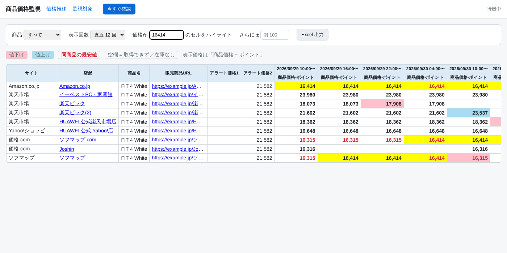

# pricewatch — 日本市场商品价格监控

自动巡回 Amazon.co.jp、楽天市場、Yahoo!ショッピング、価格.com 以及各家电量贩店的商品页面，
记录「商品価格 − ポイント」，与上一次比较，检测到变化时发送通知。
可以直接导入现在使用的 Excel 表格，结果也能以同样的格式导出 Excel。



## 功能

| 功能 | 说明 |
| --- | --- |
| 自动巡回 | 按设定间隔（默认 60 分钟）访问所有监控对象，获取价格・积分・库存 |
| 价格-积分 | 计算「商品価格 − ポイント」。积分优先从页面获取，也可以给每行指定固定返点率（%） |
| 价格.com | 一个商品页面里有多家店铺，按「店舗」名找到对应行。同一 URL 每次巡回只访问一次 |
| 变动检测 | 降价・涨价・低于预警价格（アラート価格1/2）・无法获取/缺货・恢复销售・同商品最低价更新 |
| 通知 | Slack / Discord / LINE（Messaging API）/ 邮件，设置了哪个就发到哪个 |
| Web 画面 | 和现在的表格一样的时间序列表：粉色=降价、蓝色=涨价、红字=同商品最低价、黄色=指定价格 ±N 高亮 |
| Excel 导出 | 同样的版式（第 1〜2 行是高亮条件，在 Excel 里改数值就会立即生效） |
| Excel/CSV 导入 | 直接读取现在的表格（自动查找「販売商品URL」所在的表头行） |

支持的网站：Amazon.co.jp、楽天市場、Yahoo!ショッピング、価格.com、ビックカメラ、コジマネット、
ヤマダウェブコム、ECカレント、ソフマップ、Joshin、エディオン、Nojima、e-best、特価COM
（其他网站也会尝试从 JSON-LD / meta 标签获取价格）。

## Windows 用户

请看 **[WINDOWS.md](WINDOWS.md)**：双击 `setup.bat` 安装 → `start.bat` 启动 → `open.bat` 打开画面，
`autostart-on.bat` 设置开机自动运行。

## 安装（Mac / Linux）

```bash
python -m venv .venv && source .venv/bin/activate
pip install -e .
cp .env.example .env   # 按需填写通知设置
```

## 使用方法

```bash
# 1. 导入监控对象（直接用现在的 Excel 即可。CSV 示例: examples/listings.csv）
pricewatch import 価格監視.xlsx

# 2. 立即检查一次
pricewatch check

# 3. 启动 Web 画面 + 每 30 分钟自动检查 → http://127.0.0.1:8000
pricewatch serve --interval 30

# 其他
pricewatch list                      # 监控对象和最新价格
pricewatch export 価格推移.xlsx --runs 30   # 用最近 30 次的数据导出 Excel
pricewatch run --interval 60         # 不开 Web 画面，只做定时检查
pricewatch test-url <URL> [--shop 店舗名]  # 检查某个 URL 能否取到价格（调整选择器用）
```

导入表格需要的列：`販売商品URL`（必需）、`サイト`、`店舗`、`商品名`、`アラート価格1`、`アラート価格2`、
`ポイント率`（可选）。サイト为空时根据 URL 自动判断。相同「URL × 店舗」会覆盖更新。

### 用 cron 定时运行（不常驻进程时）

```cron
*/30 * * * * cd /path/to/pricewatch && .venv/bin/pricewatch check >> data/cron.log 2>&1
```

## 通知规则

- **降价 / 涨价**：与该店铺上一次成功获取的价格比较
- **低于预警价格**：「价格−积分」低于 アラート価格1 或 2 时。只在**刚跌破时**通知一次，持续低于时不重复通知
  （首次检查时如果已经低于也会通知）
- **最低价更新**：同一商品所有店铺的最低价低于之前的最低价
- **无法获取 / 恢复销售**：上次能取到价格、这次取不到（缺货・页面下架・被拦截等），以及相反的情况

## 准确性相关的注意点（请务必阅读）

- **各网站的 HTML 会改版。** 选择器失效时会退回到 JSON-LD / meta 标签，但仍可能取不到。
  请用 `pricewatch test-url <URL>` 确认，并调整 `pricewatch/parsers/__init__.py` 里的选择器。
  建议先用自己的实际 URL 跑一次 `pricewatch check`，和页面上的价格核对。
- **积分因会员等级・活动而异。** 页面上显示的是未登录状态的积分。要和表格保持一致，
  推荐用 `ポイント率` 列指定固定返点率（例如家电量贩店 10%）。
- **Amazon 的反爬虫很严格**，普通 HTTP 请求经常被拦截。可以设置 `PRICEWATCH_AUTO_BROWSER=1`，
  并执行 `pip install -e '.[browser]' && playwright install chromium`，只有 Amazon 会用浏览器获取。
  长期稳定运营的话，建议使用 Amazon 的官方 API（PA-API）。
- 楽天・Yahoo! 也有官方商品 API（需要应用 ID），量大时比抓取页面更稳定。
- 同一网站的访问间隔默认 3 秒（`PRICEWATCH_DELAY`）。请遵守各网站的使用条款，不要设置过于频繁的间隔。

## 开发

```bash
pip install -e '.[dev]'
pytest
```

```
pricewatch/
  parsers/      各网站的价格・积分・库存解析（__init__.py 里是网站设置）
  fetch.py      HTTP 获取（按域名控制间隔・重试・Shift_JIS 判断・缓存）
  monitor.py    巡回和变动检测
  notify.py     Slack / Discord / LINE / 邮件
  report.py     时间序列表和 Excel 导出
  importer.py   Excel / CSV 导入
  scheduler.py  定时检查
  web/          Web 画面（Flask）
  cli.py        命令
```
